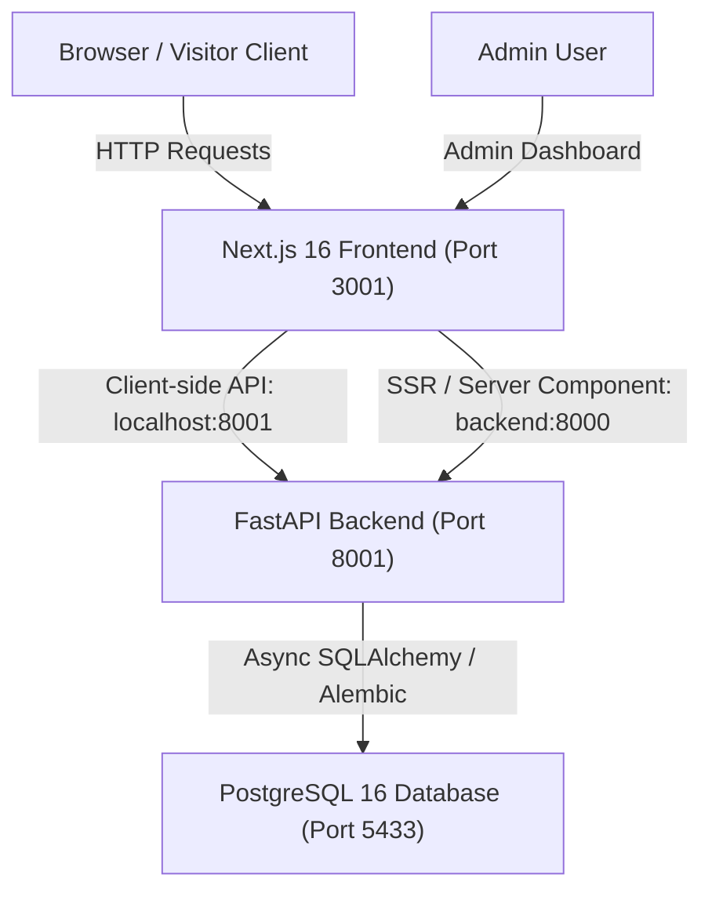

# Shabnum H. — Full-Stack AI Engineer Portfolio & CMS

> A production-ready portfolio, interactive service platform, and content management system for Shabnum H., an AI Engineer and Backend Developer building practical AI applications, workflow automation, RAG systems, and dependable Python backends.

---

## 🌟 Overview

This project is a modern, high-performance full-stack application featuring:
- **Client Portfolio**: Responsive, dark-themed presentation showcase highlighting AI/ML engineering, RAG pipelines, agentic workflows, and backend platforms.
- **Inquiry Management**: End-to-end contact and project brief intake persisted directly to PostgreSQL.
- **Admin CMS & Triage**: Secure management dashboard for content authoring, inquiry triage, and system audit logs.
- **Dockerized Architecture**: Fully containerized environment with multi-stage builds, non-root users, automated migrations, seeders, and health checks.

---

## 🛠️ Architecture & Tech Stack



### Frontend
- **Framework:** Next.js 16 (React 19, TypeScript)
- **Styling:** Tailwind CSS 4 with custom design tokens
- **Routing:** App Router with Route Groups (`(public)` and `admin`)
- **State & Data Fetching:** Server Components + Client-side fetchers with cookie-based JWT authentication

### Backend
- **Framework:** FastAPI (Python 3.12)
- **Database ORM:** SQLAlchemy 2.0 (Asyncpg / psycopg)
- **Migrations:** Alembic
- **Validation & Serialization:** Pydantic v2 & Pydantic Settings
- **Security:** Argon2 / bcrypt password hashing, HTTP-only secure cookie JWT sessions, rate limiting, and CORS protection
- **API Documentation:** Interactive Swagger UI (`/docs`) and ReDoc (`/redoc`)

### Infrastructure & Database
- **Database:** PostgreSQL 16 Alpine
- **Containerization:** Multi-stage Dockerfiles for Frontend and Backend
- **Orchestration:** Docker Compose with dedicated service networks, persistent named volumes, and automated health checks

---

## 📂 Project Structure

```text
ai-engineer-portfolio/
├── app/
│   ├── (public)/                 # Public portfolio pages
│   │   ├── about/                # Bio, engineering approach, and credentials
│   │   ├── contact/              # Interactive inquiry form & contact details
│   │   ├── projects/             # Project showcase and filterable index
│   │   │   └── [slug]/           # Dynamic project case study details
│   │   ├── services/             # AI & backend services catalog
│   │   └── skills/               # Full capability & technology map
│   ├── admin/                    # Secure Admin CMS
│   │   ├── inquiries/            # Inquiry inbox, status workflow, and triage
│   │   ├── projects/             # Project catalog manager
│   │   ├── services/             # Service catalog manager
│   │   ├── skills/               # Skills and capability manager
│   │   ├── experience/           # Timeline and credential manager
│   │   ├── audit-logs/           # System activity and security audit trail
│   │   └── login/                # Admin authentication portal
│   ├── components/               # Shared UI primitives, navigation, and footer
│   └── globals.css               # Design system and Tailwind CSS tokens
├── backend/
│   ├── alembic/                  # Database migration versions and environments
│   ├── app/
│   │   ├── api/v1/               # REST API endpoints (auth, inquiries, content, health)
│   │   ├── core/                 # App configuration, security, and database session
│   │   ├── models/               # SQLAlchemy ORM models
│   │   ├── schemas/              # Pydantic request/response schemas
│   │   └── services/             # Business logic and database operations
│   ├── tests/                    # Pytest test suite covering endpoints and auth
│   ├── Dockerfile                # Multi-stage production Python build
│   └── docker-entrypoint.sh      # Container entrypoint with auto-migration and seeding
├── lib/
│   ├── admin/                    # Admin API client and cookie management
│   ├── public-api.ts             # Public API integration (SSR and browser fallback)
│   ├── site-config.ts            # Profile configuration and metadata
│   └── *-data.ts                 # Default fallback and static content catalogs
├── docker-compose.yml            # Multi-service production-like compose file
├── Dockerfile                    # Next.js standalone multi-stage production build
├── .env.docker.example           # Reference template for Docker Compose deployment
└── .env.example                  # Reference template for local development
```

---

## 🚀 Getting Started

### Option 1: Running with Docker Compose (Recommended)

1. **Clone the repository:**
   ```bash
   git clone https://github.com/mahtabhussainofficial/ai-engineer-portfolio.git
   cd ai-engineer-portfolio
   ```

2. **Configure Environment Variables:**
   Copy the example Docker environment file:
   ```bash
   cp .env.docker.example .env
   ```
   *Update `SECRET_KEY`, `POSTGRES_PASSWORD`, and admin credentials with secure values.*

3. **Start the Containers:**
   ```bash
   docker compose up -d --build
   ```

4. **Access the Application:**
   - **Frontend:** [http://localhost:3001](http://localhost:3001)
   - **Backend API:** [http://localhost:8001](http://localhost:8001)
   - **API Docs (Swagger):** [http://localhost:8001/docs](http://localhost:8001/docs)
   - **Admin Portal:** [http://localhost:3001/admin/login](http://localhost:3001/admin/login)

---

### Option 2: Local Development Without Docker

#### Backend Setup
```bash
cd backend
python -m venv venv
# On Windows:
.\venv\Scripts\activate
# On Linux/macOS:
source venv/bin/activate

pip install -r requirements.txt
cp .env.example .env
alembic upgrade head
python -m app.initial_data
uvicorn app.main:app --reload --port 8000
```

#### Frontend Setup
```bash
# In the project root:
npm install
npm run dev
```
Open [http://localhost:3000](http://localhost:3000) in your browser.

---

## 🧪 Testing & Code Quality

### Frontend Checks
```bash
# Type check:
npx tsc --noEmit

# ESLint:
npm run lint

# Production build test:
npm run build
```

### Backend Checks
```bash
# Run Pytest suite:
docker compose exec backend pytest
# Or in local venv:
pytest backend/tests
```

---

## 🛡️ Security & Production Considerations

- **Secrets Isolation:** `.env` files and sensitive credentials are excluded from version control and Docker images via `.gitignore` and `.dockerignore`.
- **Non-Root Execution:** Docker containers run under dedicated unprivileged users (`nextjs` and `appuser`).
- **HTTP-Only Cookies:** Admin session tokens are managed via secure, HttpOnly, SameSite cookies to protect against XSS and CSRF.
- **CORS Protection:** Strict origin validation restricts API access to authorized frontend origins.
- **Port Conflict Handling:** Configured with host ports (`3001` frontend, `8001` backend, `5433` postgres) to prevent collisions with host services during local deployment.

---

## 📄 License

This repository is a personal portfolio and platform codebase. Contact the repository owner before reusing branding, personal copy, or media assets.
