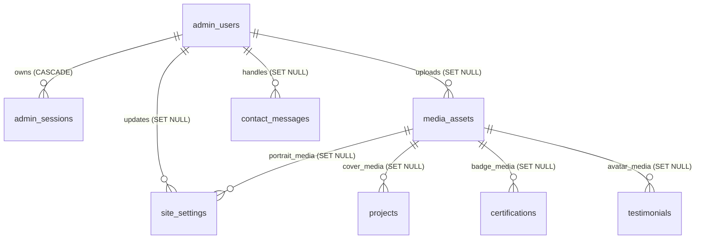

# Database Schema Architecture

This document describes the PostgreSQL database architecture for the AI Engineer Portfolio backend (`backend/app/models/` and `backend/alembic/versions/20261112_0001_initial_schema.py`).

## Design Principles

- **SQLAlchemy 2.x typed models** using `Mapped[...]` and `mapped_column(...)`.
- **UUID primary keys** (`UUID` in PostgreSQL) on all tables to avoid sequential enumeration in public/admin APIs and support distributed ID generation.
- **Timezone-aware audit timestamps** (`created_at`, `updated_at` as `TIMESTAMPTZ` defaulting to `now()`) on every table.
- **Deterministic constraint naming** (`ix_`, `uq_`, `ck_`, `fk_`, `pk_`) configured on `Base.metadata` for clean, predictable Alembic migrations.
- **Relational normalization first**: Core entities (`projects`, `services`, `skills`, `experience`, `education`, `certifications`, `testimonials`, `contact_messages`, `media_assets`, `admin_users`, `admin_sessions`) are dedicated relational tables. `JSONB` is restricted exclusively to `site_settings.value` for genuinely flexible structured settings blocks (site profile, hero copy, connect channels, profile highlights, engineering principles, and process steps).
- **PostgreSQL arrays for simple ordered string lists**: `projects.deliverables`, `projects.tags`, `services.tools`, `services.home_tags`, `skills.items`, and `skills.featured_tags` use native PostgreSQL `ARRAY` columns rather than `JSONB`.
- **Draft / published lifecycle**: Portfolio content tables include `publish_status` (`draft` | `published`), `published_at`, and `display_order` for deterministic section ordering.
- **External media storage**: `media_assets` stores external storage URLs, provider metadata, MIME type, and dimensions — never image binaries in PostgreSQL.

## Entity-Relationship Overview

## Tables

### 1. `admin_users`
Stores portfolio administrator credentials and roles.
- **Columns**: `id` (UUID PK), `email` (VARCHAR(255), UNIQUE), `full_name` (VARCHAR(120)), `password_hash` (VARCHAR(255)), `role` (`super_admin` | `admin`), `is_active` (BOOLEAN), `last_login_at` (TIMESTAMPTZ, nullable), `created_at`, `updated_at`.
- **Constraints**: `uq_admin_users_email`, `ck_admin_users_valid_role`.

### 2. `admin_sessions`
Tracks active and revoked refresh sessions for portfolio administrators.
- **Columns**: `id` (UUID PK), `admin_user_id` (UUID FK -> `admin_users.id` ON DELETE CASCADE), `refresh_token_hash` (VARCHAR(255), UNIQUE), `user_agent` (VARCHAR(512), nullable), `ip_address` (VARCHAR(45), nullable), `expires_at` (TIMESTAMPTZ), `revoked_at` (TIMESTAMPTZ, nullable), `created_at`, `updated_at`.
- **Indexes**: `ix_admin_sessions_admin_user_id`, `ix_admin_sessions_expires_at`, `ix_admin_sessions_user_expires (admin_user_id, expires_at)`.
- **Delete behavior**: Deleting an `admin_users` row cascades to delete all its `admin_sessions`.

### 3. `media_assets`
Metadata catalog for externally hosted images, badges, avatars, and files (e.g., S3, Cloudflare R2, Cloudinary, or Next.js `public/` references).
- **Columns**: `id` (UUID PK), `title` (VARCHAR(200)), `file_name` (VARCHAR(255)), `storage_provider` (`external` | `s3` | `r2` | `cloudinary` | `local_public`), `storage_key` (VARCHAR(512), nullable), `url` (VARCHAR(1000)), `mime_type` (VARCHAR(100)), `file_size_bytes` (BIGINT, nullable), `width` (INT, nullable), `height` (INT, nullable), `alt_text` (VARCHAR(300), nullable), `caption` (VARCHAR(500), nullable), `uploaded_by_id` (UUID FK -> `admin_users.id` ON DELETE SET NULL, nullable), `created_at`, `updated_at`.
- **Constraints**: Non-negative `file_size_bytes`, positive `width`/`height`, valid `storage_provider`.
- **Indexes**: `ix_media_assets_uploaded_by_id`, `ix_media_assets_provider_mime`.

### 4. `site_settings`
Key-value `JSONB` configuration store mapping cleanly to `lib/site-config.ts`, `lib/about-data.ts`, and `PROCESS_STEPS` in `lib/services-data.ts`.
- **Columns**: `id` (UUID PK), `key` (VARCHAR(100), UNIQUE), `label` (VARCHAR(150)), `category` (VARCHAR(50)), `description` (TEXT, nullable), `value` (JSONB), `is_public` (BOOLEAN), `portrait_media_id` (UUID FK -> `media_assets.id` ON DELETE SET NULL, nullable), `updated_by_id` (UUID FK -> `admin_users.id` ON DELETE SET NULL, nullable), `created_at`, `updated_at`.
- **Indexes**: `ix_site_settings_category_public`, `ix_site_settings_portrait_media_id`, `ix_site_settings_updated_by_id`.
- **Rationale**: Using keyed `JSONB` records avoids creating separate single-row tables for semi-structured UI blocks (hero content, connect channels, profile highlights, process steps) while keeping public/private visibility explicit via `is_public`.

### 5. `projects`
Portfolio case studies and concept briefs (`lib/projects-data.ts`).
- **Columns**: `id` (UUID PK), `slug` (VARCHAR(150), UNIQUE), `display_number` (VARCHAR(16), nullable), `title` (VARCHAR(200)), `category` (VARCHAR(100)), `home_category_label` (VARCHAR(100), nullable), `project_type` (`Concept Brief` | `Case Study`), `publish_status` (`draft` | `published`), `published_at` (TIMESTAMPTZ, nullable), `featured` (BOOLEAN), `display_order` (INT), `summary` (TEXT), `problem` (TEXT), `solution` (TEXT), `deliverables` (TEXT[]), `tags` (VARCHAR(80)[]), `live_url` (VARCHAR(500), nullable), `repo_url` (VARCHAR(500), nullable), `cover_media_id` (UUID FK -> `media_assets.id` ON DELETE SET NULL, nullable), `created_at`, `updated_at`.
- **Indexes**: `uq_projects_slug`, `ix_projects_category`, `ix_projects_cover_media_id`, `ix_projects_status_order (publish_status, display_order)`, `ix_projects_featured_status_order (featured, publish_status, display_order)`.

### 6. `services`
Service offerings catalog (`lib/services-data.ts`).
- **Columns**: `id` (UUID PK), `display_number` (VARCHAR(16), nullable), `category` (VARCHAR(100)), `domain` (VARCHAR(100)), `title` (VARCHAR(200)), `description` (TEXT), `tools` (VARCHAR(100)[]), `featured` (BOOLEAN), `home_category_label` (VARCHAR(100), nullable), `home_title` (VARCHAR(200), nullable), `home_description` (TEXT, nullable), `home_tags` (VARCHAR(100)[], nullable), `publish_status`, `published_at`, `display_order`, `created_at`, `updated_at`.
- **Indexes**: `ix_services_category`, `ix_services_status_order`, `ix_services_featured_status_order`.

### 7. `skills`
Layered technical skill groups (`lib/skills-data.ts`) supporting `ai`, `backend`, and `delivery` layers plus optional homepage featured overrides.
- **Columns**: `id` (UUID PK), `layer` (`ai` | `backend` | `delivery`), `display_number` (VARCHAR(16), nullable), `domain` (VARCHAR(100)), `title` (VARCHAR(200)), `description` (TEXT), `items` (VARCHAR(120)[]), `featured` (BOOLEAN), `featured_category` (VARCHAR(100), nullable), `featured_title` (VARCHAR(200), nullable), `featured_description` (TEXT, nullable), `featured_tags` (VARCHAR(100)[], nullable), `publish_status`, `published_at`, `display_order`, `created_at`, `updated_at`.
- **Indexes**: `ix_skills_layer_order`, `ix_skills_status_order`, `ix_skills_featured_status_order`.

### 8. `experience`
Career timeline entries (`lib/experience-data.ts`).
- **Columns**: `id` (UUID PK), `period` (VARCHAR(100)), `role` (VARCHAR(200)), `organization` (VARCHAR(200)), `location` (VARCHAR(150), nullable), `summary` (TEXT), `is_current` (BOOLEAN), `publish_status`, `published_at`, `display_order`, `created_at`, `updated_at`.
- **Indexes**: `ix_experience_status_order`.

### 9. `education`
Academic credentials (`lib/experience-data.ts`).
- **Columns**: `id` (UUID PK), `period` (VARCHAR(100)), `degree` (VARCHAR(200)), `institution` (VARCHAR(200)), `field_of_study` (VARCHAR(200), nullable), `description` (TEXT, nullable), `publish_status`, `published_at`, `display_order`, `created_at`, `updated_at`.
- **Indexes**: `ix_education_status_order`.

### 10. `certifications`
Professional certifications (`lib/experience-data.ts`).
- **Columns**: `id` (UUID PK), `year` (VARCHAR(20)), `title` (VARCHAR(200)), `issuer` (VARCHAR(200)), `credential_id` (VARCHAR(150), nullable), `credential_url` (VARCHAR(500), nullable), `badge_media_id` (UUID FK -> `media_assets.id` ON DELETE SET NULL, nullable), `publish_status`, `published_at`, `display_order`, `created_at`, `updated_at`.
- **Indexes**: `ix_certifications_badge_media_id`, `ix_certifications_status_order`.

### 11. `testimonials`
Client feedback and testimonials (`CLIENT_FEEDBACK` in `lib/site-config.ts`).
- **Columns**: `id` (UUID PK), `title` (VARCHAR(200)), `author_name` (VARCHAR(150), nullable), `author_role` (VARCHAR(150), nullable), `quote` (TEXT, nullable), `rating_score` (NUMERIC(2,1), nullable, 1.0–5.0), `rating_label` (VARCHAR(50)), `stars` (SMALLINT, 1–5), `source` (VARCHAR(150)), `source_url` (VARCHAR(500), nullable), `avatar_media_id` (UUID FK -> `media_assets.id` ON DELETE SET NULL, nullable), `featured` (BOOLEAN), `publish_status`, `published_at`, `display_order`, `created_at`, `updated_at`.
- **Notes**: `author_name`, `author_role`, and `quote` are intentionally nullable so summary profile feedback entries (such as platform rating summaries) do not require fabricated client quotes or names.
- **Indexes**: `ix_testimonials_avatar_media_id`, `ix_testimonials_status_order`, `ix_testimonials_featured_status_order`.

### 12. `contact_messages`
Inbound inquiries submitted via `/contact` (`app/(public)/contact/contact-form.tsx`).
- **Columns**: `id` (UUID PK), `inquiry_mode` (`project` | `advisory`), `sender_name` (VARCHAR(150)), `sender_email` (VARCHAR(255)), `subject` (VARCHAR(255)), `project_type` (VARCHAR(100)), `message` (TEXT), `status` (`unread` | `read` | `archived`), `admin_notes` (TEXT, nullable), `source_ip` (VARCHAR(45), nullable), `user_agent` (VARCHAR(512), nullable), `read_at` (TIMESTAMPTZ, nullable), `archived_at` (TIMESTAMPTZ, nullable), `handled_by_id` (UUID FK -> `admin_users.id` ON DELETE SET NULL, nullable), `created_at`, `updated_at`.
- **Indexes**: `ix_contact_messages_sender_email`, `ix_contact_messages_handled_by_id`, `ix_contact_messages_status_created (status, created_at)`.

## Relationship & Delete Behavior Summary

| Parent Table | Child Table | Foreign Key | On Delete | Rationale |
| --- | --- | --- | --- | --- |
| `admin_users` | `admin_sessions` | `admin_user_id` | `CASCADE` | Sessions have no meaning without their owning admin account. |
| `admin_users` | `media_assets` | `uploaded_by_id` | `SET NULL` | Preserve published media records if an admin account is removed. |
| `admin_users` | `site_settings` | `updated_by_id` | `SET NULL` | Preserve site configuration if an admin account is removed. |
| `admin_users` | `contact_messages` | `handled_by_id` | `SET NULL` | Preserve inquiry history if an admin account is removed. |
| `media_assets` | `site_settings` | `portrait_media_id` | `SET NULL` | Removing a media asset must not delete site settings. |
| `media_assets` | `projects` | `cover_media_id` | `SET NULL` | Removing a cover image must not delete the project case study. |
| `media_assets` | `certifications` | `badge_media_id` | `SET NULL` | Removing a badge image must not delete the certification record. |
| `media_assets` | `testimonials` | `avatar_media_id` | `SET NULL` | Removing an avatar image must not delete the testimonial record. |
